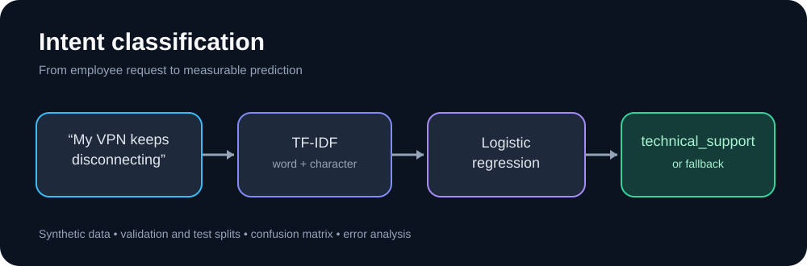

# Charishma Chand Thurimella

**NLP Data Scientist | Conversational AI | Python**

I work on conversational systems and the testing that makes them dependable. My interests include intent classification, entity extraction, routing across support domains, and evaluating how language models behave when users ask unexpected questions.

At Bank of America, I worked on Erica for Employees, an internal assistant built with SoundHound Amelia AI. My responsibilities included preparing intent and entity data, investigating routing and classification errors, and validating changes across employee-support workflows.

This repository contains small, independent projects I use to explore those engineering problems. They use synthetic examples, not internal employer data or code.

**[Explore the illustrated project showcase](SHOWCASE.md)**

## Projects

### [Intent classification](intent-classifier/)

A scikit-learn baseline that combines word and character TF-IDF features with logistic regression. Includes separate training, validation, and test datasets, error analysis, and automated tests.

**Measured on synthetic data:** validation macro F1 0.975 (40 examples); held-out test macro F1 0.948 (40 examples). These are small, curated datasets rather than evidence of production performance.

### [Document question answering](document-rag/)
A local passage-retrieval and extractive answering system. It ranks passages using TF-IDF and cosine similarity, returns source filenames, and abstains when the match is weak.

**Measured on synthetic data:** 12/12 top-1 document matches. This is not a generative LLM or a full RAG application.

### [Conversation regression tests](conversation-regression/)
A rule-based routing baseline and regression suite covering intent selection, ticket IDs, leave-day extraction, ambiguous requests, and fallback behavior.

**Measured on authored cases:** 35/35 intent matches and 35/35 entity exact matches. These cases check expected behavior; they are not an independent generalization benchmark.

## Working with the code

Each project has its own README, requirements file, and tests. GitHub Actions runs the checks on changes. The [safety checklist](PUBLICATION_CHECKLIST.md) records verified results and outstanding post-publication reviews.

## Technical interests

Python, SQL, scikit-learn, conversational AI, NLP evaluation, retrieval, regression testing, and LLM application design.

## Contact

- [LinkedIn](https://www.linkedin.com/in/charishma-chand-t-125229305/)
- [GitHub](https://github.com/charishmathurimella)
- [Email](mailto:charishmathurimella@gmail.com)

**Publication status:** Public. The remaining privacy, ownership, and history checks are documented in the [safety checklist](PUBLICATION_CHECKLIST.md).
