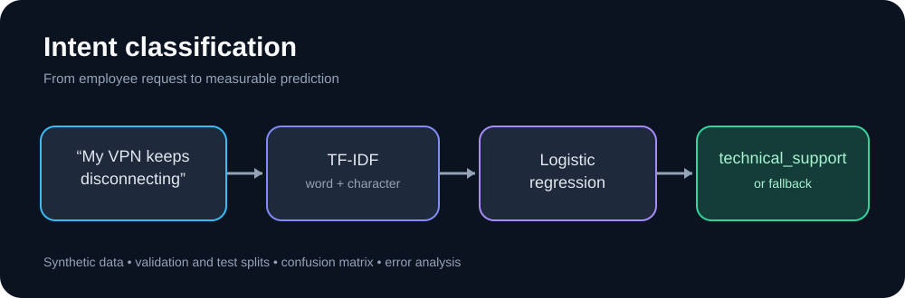
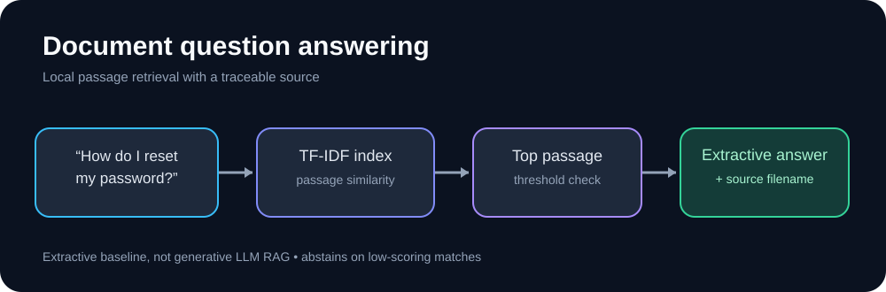
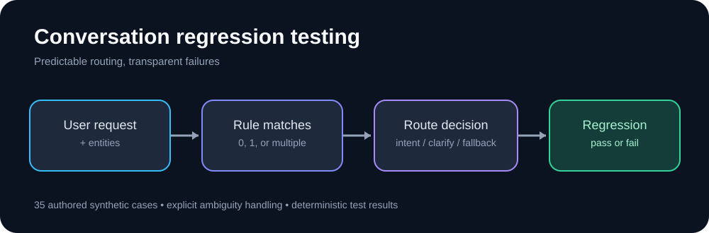

# Project showcase

Three small projects exploring how to build, evaluate, and test language-driven software. Each project uses fictional employee-support requests and can run locally.

## 1. Classify an employee request

**Try:** `python intent-classifier/train.py --text "My laptop will not start"`

**What to look for:** the predicted intent, confidence, and fallback behavior. The pipeline combines word and character TF-IDF features with logistic regression.

**Verified evaluation:** 0.948 macro F1 on 40 synthetic test examples. [Implementation and setup](intent-classifier/).

## 2. Find an answer in a document

**Try:** From `document-rag/`, run `python rag.py "How do I reset my password?"`.

**What to look for:** the extracted passage, its source filename, and retrieval score. The system declines to answer when no match clears its threshold.

**Verified evaluation:** 12/12 expected top-1 documents retrieved on the authored synthetic question set. This is extractive retrieval, not generative RAG. [Implementation and setup](document-rag/).

## 3. Test conversation routing

**Try:** From `conversation-regression/`, run `python router.py "My password and VPN both fail"`.

**What to look for:** the `clarification` route when a request spans multiple intents. Then run `python run_regression.py` to check all authored cases.

**Verified evaluation:** 35/35 expected intent matches and 35/35 entity exact matches on authored regression cases. [Implementation and setup](conversation-regression/).

## Why the results are presented this way

The evaluations are deliberately small and synthetic. They demonstrate test design and reproducibility, not production accuracy. The repository contains independent examples, not internal employer implementations.

See [publication readiness](PUBLICATION_CHECKLIST.md) for the current release status.
