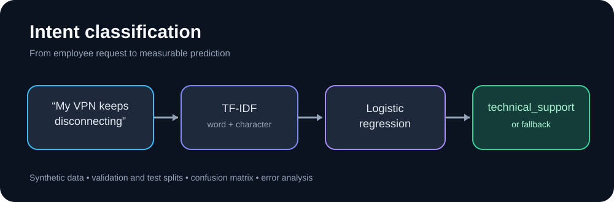

# Intent classification

This project trains a four-class intent classifier for fictional employee-support requests. The goal is to make model behavior easy to inspect, rather than to maximize a score on a large benchmark.



## Example

| Input | Expected intent |
|---|---|
| `My laptop will not start` | `technical_support` |
| `I forgot my password` | `account_access` |
| `Where is my paycheck?` | `payroll` |

These are illustrative labels, not a claim that every example was separately tested.

## How it works

The pipeline combines word and character TF-IDF features and fits a class-balanced logistic regression model. A confidence threshold can route low-confidence predictions to a fallback label.

The dataset contains 180 training examples, 40 validation examples, and 40 test examples across account access, technical support, leave policy, and payroll. The training examples include repeated phrasing patterns. All data is synthetic.

## Run it

```bash
python -m pip install -r requirements.txt
python train.py
python train.py --text "My laptop will not start"
python validate.py
python -m pytest -q
```

## Results

In the verified GitHub Actions run on November 1, 2026:

| Evaluation | Accuracy | Macro F1 | Examples |
|---|---:|---:|---:|
| Validation | 0.975 | 0.975 | 40 |
| Held-out test | 0.950 | 0.948 | 40 |

Eleven unit tests passed. The test errors were both payroll examples routed to other intents.

## What I'd improve next

The examples are curated and linguistically similar, so these results do not establish real-world generalization. A stronger evaluation would include independently collected queries, more ambiguous requests, confidence calibration, and explicit out-of-domain examples. The test set should not be reused to tune the model.

See [VALIDATION.md](VALIDATION.md) for the test breakdown.
